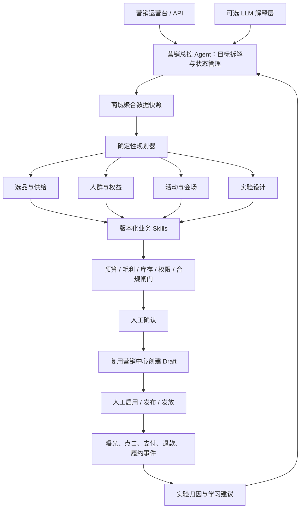

# 社区团购营销 Agent：产品设计、案例与落地方法论

> 文档版本：v1.0（2026-08-01）
> 适用对象：客户管理层、营销/商城运营、产品、数据、技术、安全与合规团队
> 数据口径声明：文中的公开数据均来自外部公开来源；案例中的提升区间和测算均为**建议试点目标或示例计算**，不是本产品已实现的客户成果，也不是收益承诺。

## 1. 一句话定位

营销 Agent 不是“替运营写文案的聊天机器人”，而是一个在库存、毛利、预算、履约、品牌与合规约束下，把经营目标转化为可审批、可执行、可实验、可复盘营销动作的操作系统。

它完成的闭环是：

> 经营目标 → 商机洞察 → 选品与人群决策 → 权益和活动设计 → 内容与会场生成 → 人工审批 → 受控执行 → 增量评估 → 策略回灌

真正可沉淀的壁垒不是某一个大模型，而是：

> 业务状态模型 × 可执行 Skills × 受控权限 × 因果实验 × 持续学习

## 2. 为什么从社区团购切入

社区团购兼具高频消费、低毛利、生鲜损耗、社区传播和强履约约束，是检验营销 Agent 是否真正懂经营的典型场景。

公开数据提供了三层市场基础：

1. **线上交易习惯成熟。**截至 2025 年 12 月，中国网络购物用户规模为 9.37 亿，占网民的 83.2%；生成式人工智能用户规模为 6.02 亿，普及率 42.8%。来源：[CNNIC 第 57 次《中国互联网络发展状况统计报告》](https://www.cnnic.net.cn/NMediaFile/2026/0304/MAIN1772588317069TUXN3827X8.pdf)。这只能证明用户基础，不能证明某个营销 Agent 的转化效果。
2. **食品线上增长快于实物网零整体。**2025 年全国实物商品网上零售额为 13.0923 万亿元，同比增长 5.2%；其中“吃类”同比增长 14.5%。来源：[国家统计局](https://www.stats.gov.cn/sj/zxfbhjd/202601/t20260119_1962323.html)。“吃类”包含全部线上食品，不能等同于社区团购规模。
3. **县域和农产品线上流通仍在增长。**商务大数据显示，2025 年全国农村网络零售额同比增长 6.7%，农产品网络零售额同比增长 9.9%。来源：[商务部](https://www.mofcom.gov.cn/syxwfb/art/2026/art_f8416017c8e24d1f83160afcf0303e10.html)。这可支持下沉市场获客和产地商品上行两个论点，但没有按具体平台拆分。

社区团购要解决的核心问题，已经不只是“有没有流量”，而是：

- 今天在哪些社区卖什么；
- 向谁提供什么权益；
- 用什么团长、内容和活动触达；
- 如何避免无效补贴、缺货和履约超载；
- 如何证明新增订单确实由营销创造，而不是自然成交。

## 3. 产品能力地图

| 场景 | Agent 的关键工作 | 主要价值 | 关键人工审批 |
|---|---|---|---|
| 智能选品 | 当前版按销量、GMV、成本、折后毛利和库存覆盖透明评分，生成主推商品池 | 提升有效供给，降低缺货和低毛利风险 | 采购、品类、供应链 |
| 自动获客 | 识别低渗透社区，生成团长任务、渠道组合、利益点、素材 Brief 和追踪方案 | 降低增量获客成本，提高首购质量 | 增长、渠道、合规 |
| 人群与发券 | 识别可被营销改变的人群，在预算约束下计算券门槛、面额、数量和频控 | 减少补贴自然订单，提高补贴效率 | 营销、财务、合规 |
| 活动生成 | 从经营目标生成机制、商品范围、排期、预算、展示标签和规则草稿 | 缩短策划周期，提高实验频率 | 活动运营、财务、法务 |
| 会场搭建 | 自动编排入口、文案、商品池与顺序，生成可预览的 `promotion_venue` 草稿 | 降低搭建成本，支持多版本实验 | 商品运营、品牌、发布负责人 |
| 复盘优化 | 设计对照组，监控增量转化、券后毛利、退款、缺货与投诉 | 从归因报表升级为因果学习 | 数据、业务负责人 |

### 3.1 当前可演示产品闭环

本版本已经实现：

- 读取商城域近 30 天的订单、商品、成本、库存、售后、券、活动、自提点和团长聚合数据；
- 计算首购、复购、沉睡、优惠敏感和售后风险人群规模，不把用户手机号、地址或姓名传给模型；
- 生成选品、团长获客、定向券、营销活动、主题会场和增量实验动作；
- 提供硬预算、折后毛利、库存、人群规模、隐私和触达授权护栏；
- 支持 MiniMax 或 OpenAI-compatible Chat Completions 模型作为解释层；密钥缺失时仍可由确定性规划器输出完整方案；
- 复用已有营销中心，只创建优惠券、活动和会场草稿；
- 草稿携带幂等键，重复创建返回原草稿；
- 幂等键由数据库唯一索引和原子写入兜底，并发请求也不会重复创建；
- 当前结算链路尚未真实执行人群和商品范围时，服务端 `activationGate` 会阻止相关 Agent 草稿被启用。

当前选品分数权重为销量 30%、GMV 20%、预估折后毛利 30%、库存覆盖 20%；只从当前在售商品中选择，最多从 30 个成交候选中取 6 个。整体售后数据目前用于经营诊断，尚未进入单商品评分；要引入售后风险，需先补齐可可信归因到 SKU 的售后明细。

当前明确不做：

- 不自动启用活动、发布会场、正式发券、群发或外呼；
- 不访问 B 端无人车业务数据；营销 Agent 只属于 C 端商城域；
- 不把“提升区间”展示成已发生的客户成果；
- 不在缺成本、低库存、折后毛利不足、预算为零或目标人群为空时回退到不安全方案。

人群口径也必须分开：`recent_first_buyers` 是近 30 天已经完成首购的人，只能用于二购/留存试点；获客场景使用社区、自提点、团长和渠道归因方案，不会把这批已购用户包装成“潜客”。当前会场发布能力是全局的，因此会场动作明确标记为 `all_customers`，不宣称具备人群定向发布。

## 4. 五个客户案例卡片

### 案例一：周末家庭餐桌——社区级智能选品

**客户问题**

同一套商品推给所有社区，容易出现年轻社区缺货、其他社区低动销、生鲜损耗和拣货压力不均。

**Agent 工作流**

1. 汇总社区、历史销量、搜索、天气、节日和价格带信息；
2. 检查可售库存、在途、保质期、成本、折后毛利和履约能力；
3. 将商品划分为引流品、利润品、场景搭配品和探索品；
4. 为不同社区生成核心 SKU 与家庭餐桌组合；
5. 模拟销售、毛利、缺货和损耗；
6. 提交采购及品类运营审批；
7. 按社区集群进行对照实验；
8. 将售罄、缺货、退款和履约结果回灌。

**建议试点目标（不是客户实绩）**

- 售罄率提升 5—8 个百分点；
- 生鲜损耗率相对下降 10%—15%；
- 需求预测 WAPE 相对下降 10%—20%；
- 毛利率不低于对照组；
- 缺货率不得恶化。

**示例测算**

假设实验覆盖 10 万名成员，社区随机分为实验组和对照组各 5 万人：

- 对照组订单率 8.0%，即 4,000 单；
- 实验组试点目标订单率 8.8%，即 4,400 单；
- 示例增量订单 400 单；
- 若客单价 45 元，示例增量 GMV 为 `400 × 45 = 18,000 元`。

是否产生正向增量利润，还必须扣除商品成本、损耗变化、补贴和履约成本。

**外部方法可行性参考**

阿里零售案例将需求预测、库存优化、促销定价和推荐结合，论文披露组合系统带来年化库存/损耗成本节省、销售和利润改善。来源：[INFORMS 同行评审案例](https://doi.org/10.1287/inte.2022.1145)。这些是多模块组合收益，不能把其中的 1.10 亿美元销售增长归因给单一“AI 选品”能力，也不能直接外推到客户项目。

### 案例二：新社区冷启动——团长与内容协同获客

**客户问题**

新社区依赖运营复制旧话术和统一礼包，渠道、人群和内容没有按社区特征优化，也无法区分自然新增和营销新增。

**Agent 工作流**

1. 根据社区渗透率、团长覆盖、自提点服务和历史首购识别机会社区；
2. 生成社区级渠道组合和获客预算；
3. 生成团长任务、群素材 Brief、短视频脚本、落地页结构和首购商品包；
4. 排除拒绝营销的用户并控制触达频率；
5. 按社区或团长集群随机分配传统方案和 Agent 方案；
6. 同时追踪首购、增量 CAC、7 日活跃和 30 日复购；
7. 对低成本但低质量的渠道停止追加预算。

**建议试点目标**

- 新客 CAC 相对下降 8%—12%；
- 首购付费用户相对提升 5%—10%；
- 30 日复购不低于对照组；
- 投诉和退订率不得恶化；
- 从 Brief 到首版物料不超过 2 小时。

**示例测算**

20 个新社区覆盖 2 万名合规可触达用户，历史 7 日首购率 3.0%：

- 基线预计首购 600 人；
- 若试点目标是相对提升 15%，目标首购率为 3.45%；
- 示例目标首购 690 人；
- 示例增量首购 90 人。

这 90 人仍需通过社区级同期对照确认，不能直接用“最后点击渠道”当作增量结论。

### 案例三：沉睡用户唤醒——预算约束的增量发券

**客户问题**

传统发券常把优惠给了本来就会购买的人。高核销率不等于高增量，可能只是用补贴购买了自然订单。

**Agent 工作流**

1. 排除拒绝营销、异常账户和高套利风险用户；
2. 比较“不发券、不同面额、不同门槛”等策略下的增量响应；
3. 识别可被营销改变的人，而不是只找高购买概率人群；
4. 在预算、单用户上限和折后毛利约束下分配权益；
5. 创建未生效券草稿，提交营销与财务审批；
6. 保留不发券对照组；
7. 监控预算、套利、投诉和毛利；
8. 以增量订单和增量贡献利润复盘。

**建议试点目标**

- 每 100 元补贴带来的增量订单相对提升 15%—25%；
- 预算偏差不超过 2%；
- 增量贡献利润为正；
- 自然订单补贴率下降；
- 无不合理差别待遇。

**示例测算**

传统策略使用 2 万元补贴，经对照组校正后带来 1,000 个增量订单：

```text
传统补贴效率 = 1000 / 20000 × 100 = 5 单 / 每100元补贴
Agent 试点目标 = 1200 / 20000 × 100 = 6 单 / 每100元补贴
相对效率目标 = 20%
```

这是试点目标测算，不是实际效果承诺。

**外部方法可行性参考**

美团合作研究在 2024 年 2—3 月于两个城市对 3,867,738 名随机用户进行了一个月实验，实时个性化方案相对离线方案使月卡收入/曝光用户提高 2.8%；不同人群效果存在显著差异，低频人群甚至出现负向变化。系统还采用 CVR 预测、预算优化和反馈控制，论文披露上线覆盖 110 多个城市、1 亿以上用户。来源：[完整论文](https://arxiv.org/html/2406.05987)。该场景是单车月卡而非社区生鲜，只能证明技术路线和实验方法可行，不能直接外推收益。

### 案例四：早餐周——一句目标生成完整活动与会场

**示例输入**

> 下周做“开学早餐周”，预算 3 万元，整体毛利率不得比基线下降超过 0.5 个百分点。

**Agent 输出**

1. 活动机制、排期和商品组合；
2. 库存、成本、折后毛利和履约检查；
3. 活动名、卖点、团长话术和视觉 Brief；
4. 首页入口、套餐区、单品区、券区和商品顺序；
5. 多个文案及排序版本；
6. 禁用词、价格、商品真实性和链接质检；
7. 审批包和会场预览；
8. 小流量实验与回滚规则。

**建议试点目标**

- 首版活动与会场工时下降 60% 以上；
- 单次活动可实验版本从 1 个增加到 3—4 个；
- 会场配置错误率低于 0.5%；
- 内容与价格硬规则检查通过率 100%；
- 收入/访客相对提升 3%—5%，必须通过在线实验确认。

**外部参考**

京东自动商品文案研究披露，截至 2021 年 9 月已生成 253 万条商品描述，并报告平均 CTR、CVR 相对基线提高 4.22% 和 3.61%。来源：[AAAI 论文](https://ojs.aaai.org/index.php/AAAI/article/view/21508)。这些来自特定系统和口径，不能作为本项目因果收益承诺；可借鉴的是“规模化生成 + 自动质检 + 人工筛选”的生产模式。

### 案例五：生鲜临期盘活——库存异常触发营销闭环

**Agent 工作流**

1. 监测库存覆盖天数、保质期、销量偏差和社区需求；
2. 找出未来 24—48 小时存在损耗风险的商品；
3. 只选择对应履约范围内的社区；
4. 模拟套餐、阶梯满减、限时活动和不促销策略；
5. 校验最低毛利、库存、拣货能力和活动叠加冲突；
6. 生成局部会场与团长内容；
7. 审批后分批放量；
8. 缺货、毛利或投诉触发护栏时暂停；
9. 复盘售罄、损耗和增量贡献。

**示例测算**

- 5,000 件商品需在 48 小时内销售；
- 历史售罄率 70%，预计售出 3,500 件；
- 试点目标售罄率 82%，目标售出 4,100 件；
- 示例新增售出 600 件；
- 假设每件扣除折扣、成本和履约后仍有 2 元增量贡献，示例增量贡献为 `600 × 2 = 1,200 元`。

该测算还未扣除活动制作和额外售后成本，最终应以匹配社区或分阶段对照验证。

## 5. 从模型到 Agent 再到 Skills：6D + G 方法论

### D1：Define——定义经营合同，而不是定义“做一个 Agent”

每个场景先写成可验证合同：

- 主指标：增量贡献利润、增量订单或增量新客；
- 成本约束：补贴、获客、模型调用和人力成本；
- 供给约束：库存、保质期、拣货和配送能力；
- 风险护栏：毛利、退款、客诉、退订、缺货和履约时效；
- 决策周期：小时级、日级或活动级；
- 自主级别：洞察、建议、草稿或受控执行。

推荐北极星指标是“增量贡献利润”，而不是单纯 GMV：

```text
增量贡献利润
= 增量收入
- 增量商品成本
- 增量补贴
- 增量获客成本
- 增量履约与售后成本
- Agent 运行成本
```

### D2：Data——建立营销决策数据合同

最低数据范围：

| 数据域 | 必要字段 |
|---|---|
| 商品 | SKU、品类、属性、成本、售价、毛利、保质期、供应商 |
| 库存 | 仓/社区、可售、在途、预警线、覆盖天数 |
| 用户与社区 | 合法取得的交易、浏览、活动响应、社区特征、营销偏好 |
| 团长 | 覆盖社区、渠道码、历史转化、履约质量、合规触达状态 |
| 营销 | 活动、券、曝光、点击、领取、核销、预算、渠道成本 |
| 交易 | 下单、支付、取消、退款、售后、贡献利润 |
| 履约 | 拣货、送达、自提、缺货、投诉、时效 |
| 内容 | 品牌规范、禁用词、合法素材、历史实验结果 |
| 实验 | 分组、版本、曝光、干预、结果事件 |

每条关键事件应携带租户、用户或社区去标识 ID、活动版本、Skill 版本、模型版本、时间戳和实验组。没有曝光与实验分组，就不能可信地声称 CVR 或营销增量。

### D3：Decide——按任务选择模型组合

不建议用一个大模型包办所有工作。

| 任务 | 推荐技术 | 选型重点 |
|---|---|---|
| 目标理解、计划生成、复盘解释 | 推理型 LLM | 中文经营理解、结构化输出、工具调用、长上下文 |
| 高频分类、字段提取、风险初筛 | 小语言模型或分类器 | 延迟、成本、稳定性 |
| 需求与销量预测 | 时序模型、GBDT、深度预测 | 缺货修正、节假日、社区冷启动 |
| 人群与发券 | Uplift、因果森林、CVR 模型 | 增量效果、校准度、公平性 |
| 预算与商品组合 | 线性规划、整数规划、背包优化 | 硬约束满足、可解释性 |
| 图片与会场素材 | 多模态理解和图像生成 | 品牌一致、商品真实性、版权 |
| 价格、预算、权限、禁用词 | 规则引擎 | 确定性、零容忍、可审计 |
| 活动知识检索 | 混合检索与 RAG | 新鲜度、来源、权限隔离 |

模型选型不能只看通用榜单。建议使用客户自己的 100—300 个代表性任务，评估：

- 业务方案可执行性；
- 工具调用成功率；
- JSON/Schema 通过率；
- 商品与政策事实准确率；
- 品牌和合规违规率；
- P95 延迟；
- 单任务成本；
- 私有化、数据驻留和审计能力。

本版本采用“双层决策”：确定性规划器负责聚合、算账、选品、预算和护栏；可选 LLM 只解释方案，不得改写预算、审批边界或草稿状态。

### D4：Design——设计 Agent 架构和自主边界



设计原则：

1. LLM 负责理解、规划和解释；SQL、预测模型、优化器和规则引擎负责算账。
2. 券、价格、触达和发布由状态机驱动，不能依赖模型临场发挥。
3. 先计划、再模拟、再校验、后执行。
4. 每个外部动作可审计、可暂停、可回滚。
5. C 端商城、B 端车辆和共享平台边界不能因为 Agent 编排而合并。

### D5：Develop——将能力封装成可治理 Skills

Skill 不是一段提示词，而是一项有类型、权限、版本、测试和回滚方式的业务能力。

当前版本的八项 Skill 定义：

这些定义当前由一个确定性规划器统一调用，已经声明数据范围、写权限、自主等级和风险等级，但尚未拆成独立部署、独立审计的 Skill Runtime。后文 L2.5 会补运行记录、动作记录和独立物化接口。

| Skill | 职责 | 写权限 | 自主等级 |
|---|---|---|---|
| `mall.data_profile` | 生成商城聚合经营快照 | 无 | 自动 |
| `mall.assortment_score` | 按销量、毛利、库存等筛选商品 | 无 | 自动 |
| `mall.audience_segment` | 计算商城域聚合人群 | 无 | 自动 |
| `mall.coupon_design` | 计算券门槛、面额、数量与预算 | `mall_coupons:draft` | 人工确认 |
| `mall.campaign_design` | 生成营销活动规则与展示草稿 | `mall_campaigns:draft` | 人工确认 |
| `mall.venue_builder` | 生成 `promotion_venue` 会场草稿 | `mall_campaigns:draft` | 人工确认 |
| `mall.experiment_design` | 设计对照组、指标与停止条件 | 无 | 自动 |
| `mall.launch_guard` | 校验预算、毛利、库存、隐私和执行闸门 | 无 | 仅人工放行 |

标准 Skill 契约示例：

```yaml
name: coupon.allocate_budget.v2
owner: growth-platform
inputs:
  cohort_id: string
  budget_cents: integer
  coupon_candidates: array
  campaign_window: object
preconditions:
  - consent_policy_passed
  - exclusion_list_applied
  - budget_reserved
outputs:
  allocation_plan: object
  expected_lift_interval: object
  worst_case_cost_cents: integer
  audit_id: string
permission: draft_only
approval: marketing_and_finance
idempotency_key: required
rollback: revoke_unissued_plan
timeout_ms: 3000
data_classification: restricted
```

关键要求：

- 读取、生成草稿、创建未生效对象和正式发布必须拆成不同 Skill；
- 每个 Skill 只获得最小权限；
- 写操作必须有幂等键；
- 长期知识更新只能生成“学习建议”，不得自动修改生产规则；
- Skill 版本、输入、输出、审批人和结果应进入审计日志。

### D6：Demonstrate & Deploy——用实验验证，再扩大权限

推荐上线顺序：

1. 历史数据回放；
2. 离线评测；
3. Shadow 模式，只给建议；
4. 生成草稿和会场预览；
5. 小流量随机对照实验；
6. 带预算上限、审计和回滚的受控执行；
7. 多场景复制。

### G：Governance——治理贯穿六个步骤

治理不是上线前的一次审核，而是持续存在于数据、模型、Skill、审批、执行和复盘中的控制层。

## 6. Agent 自主等级与权限矩阵

| 等级 | 能力 | 建议阶段 |
|---|---|---|
| L0 洞察 | 分析和解释数据 | 数据接入初期 |
| L1 建议 | 生成选品、活动和人群建议 | 首次试点 |
| L2 草稿 | 创建未生效券、活动和会场预览 | 当前版本 |
| L3 受控执行 | 在预审批策略和预算上限内执行，可自动暂停 | 连续通过实验后 |
| L4 自主经营 | 自主改预算、价格和人群并发布 | 首期不开放 |

| 动作 | 当前 Agent 权限 |
|---|---|
| 查询商城去标识化聚合数据 | 自动 |
| 预测、评分、模拟券策略 | 自动 |
| 生成内容 Brief 和会场方案 | 自动 |
| 创建未生效券、活动、会场草稿 | 人工确认后 |
| 修改价格、成本、库存 | 禁止 |
| 正式发券、发送消息、购买媒体 | 禁止 |
| 启用定向活动或发布会场 | 人工；未通过执行闸门时服务端拒绝 |
| 增加预算、延长周期 | 禁止自动执行 |
| 风险超限后暂停 | L3 可开放 |
| 修改 Skill、提示词、长期规则 | 只能提交变更建议 |

## 7. KPI 与增量实验

### 7.1 KPI 树

| 场景 | 主指标 | 护栏指标 |
|---|---|---|
| 选品 | 增量贡献利润、售罄率、预测误差 | 毛利、缺货、损耗、履约负载 |
| 获客 | 增量新客、增量 CAC、首购转化 | 30 日复购、投诉、退订、团长成本 |
| 发券 | 每 100 元补贴的增量订单、增量毛利 | 超支、自然订单蚕食、套利、公平性 |
| 活动 | 增量 GMV、增量利润、收入/访客 | 毛利、退款、售后、品牌违规 |
| 会场 | CVR、加购率、收入/访客、搭建工时 | 页面错误、加载速度、内容合规 |
| 复盘 | 实验成功率、洞察周期、策略复用率 | 错误归因、漂移、恢复时间 |

领券率、点击率和 Agent 采纳率只能作为过程指标，不能作为最终商业价值。

### 7.2 实验原则

> 归因报表说明“谁拿到了订单功劳”；随机对照实验才说明“营销是否创造了新增价值”。

- 社区团购存在群内分享和团长影响，应优先按社区、团长或网格仓集群随机；
- 个性化券若不可转让，可按用户随机；
- 实验前登记主指标、最小可检测效应、样本量、周期和停止规则；
- 实验组与对照组必须同期，尽量保持库存、价格和履约条件一致；
- 采用意向治疗口径，不能只统计实际打开或领券的人；
- 同时观察即时转化、复购、退款和贡献利润；
- 报告区间和不确定性，不只报一个提升百分比；
- 小客户可以采用匹配社区、交叉实验或分阶段上线，不强行声称显著。

## 8. 公开事实、用途与边界

| 公开事实 | 可支持的销售论点 | 不可越过的边界 |
|---|---|---|
| 北京 2021 年 4,142 份有效问卷中，86.2% 和 73.6% 的受访者购物时关注质量和价格。[北京调查总队](https://tjj.beijing.gov.cn/zxfbu/202106/t20210622_2418248.html) | 选品不能只优化低价，还要兼顾质量和履约 | 样本、地域、年份和抽样方式限制明显，不能外推全国渗透率 |
| 微信小程序 2024 年促成交易额 8 万亿元；微信/WeChat 月活超过 14 亿。[腾讯官方](https://www.tencent.com/zh-cn/products/weixin-wechat/) | 微信生态可承载社群—会场—支付—复购闭环 | 全生态数据，不是社区团购规模，也不是 Agent 增量 |
| Meta 2022 年披露 15 个 A/B 测试中，自动化购物广告平均降低购买转化成本 12%。[Meta 官方](https://about.fb.com/news/2022/08/introducing-new-automation-tools-to-increase-sales-and-drive-growth/) | 人群、创意和预算联动可以成为自动获客参考 | 海外平台自有实验，行业、地区、样本细节有限 |
| 阿里鹿班技术文章披露特定智能模板 A/B 测试 CTR 平均提高 13%。[阿里云技术文章](https://www.alibabacloud.com/blog/the-evolution-of-luban-in-designing-one-billion-images_596118) | 会场 Agent 应是多版本素材工厂和实验系统 | 数据较旧且是特定模板 CTR，不能等同于交易增量 |

对客户最可信的说法不是“承诺复制别人 10% 的提升”，而是：

> 在客户自己的社区、商品、预算和履约条件下，用受控实验给出可审计的增量结论。

## 9. 安全与合规

### 9.1 数据与系统安全

- 用户身份和营销特征去标识化；
- 非必要个人信息不进入通用模型；
- 租户、部门和活动数据隔离；
- 密钥由凭证系统管理，不写入前端或日志；
- 检索内容视为不可信输入，防止商品描述或外部页面提示注入；
- 券、预算和触达设置活动级、日级和用户级上限；
- 使用幂等键防止重复创建、发券和触达；
- 提供全局停止开关和单活动回滚。

### 9.2 用户权益

《个人信息保护法》第二十四条要求自动化决策保持透明、公平、公正；用于信息推送和商业营销时，应提供不针对个人特征的选项或便捷拒绝方式。来源：[国家市场监督管理总局转载全文](https://www.samr.gov.cn/wljys/gzzd/art/2023/art_3ef1e889c1e644d4b65b5f5c7f432386.html)。

《互联网信息服务算法推荐管理规定》涉及用户标签、人工干预、算法说明、关闭个性化推荐和删除标签等要求。来源：[中国网信网](https://www.cac.gov.cn/2022-01/04/c_1642894606364259.htm)。

因此系统至少应提供：

- 营销退订和非个性化选项；
- 用户标签查询、纠正或删除机制；
- 不使用敏感属性推断消费能力；
- 不进行不合理价格差别待遇；
- 对重要自动化决策保留解释和申诉通道；
- 适用时开展个人信息保护影响评估；
- 生成式内容按适用法规完成标识。参考：[人工智能生成合成内容标识办法](https://www.cac.gov.cn/2025-03/14/c_1743654684782215.htm)。

具体适用范围需由客户法务和数据合规负责人确认。整体治理可参考 [NIST AI Risk Management Framework](https://www.nist.gov/itl/ai-risk-management-framework) 的 Govern、Map、Measure、Manage 四个环节。

## 10. 推荐 8 周试点

### 双跑道

**跑道 A：快速见效、低风险**

选择“活动生成 + 会场搭建”，验证：

- 首版生产时间；
- 人工修改率；
- 配置错误率；
- 品牌与合规通过率；
- 实验版本数；
- 收入/访客的在线实验结果。

**跑道 B：经营价值、可量化**

选择“智能选品”或“沉睡用户发券”，验证：

- 增量贡献利润；
- 补贴效率；
- 售罄和损耗；
- 毛利与履约护栏；
- Agent 与人工基线差异。

### 计划

| 阶段 | 工作 |
|---|---|
| 第 1—2 周 | 数据和流程盘点、基线测量、定义成功标准 |
| 第 3—4 周 | 历史回放、离线评测、Shadow 运行 |
| 第 5—6 周 | 生成草稿与会场预览、小流量对照实验 |
| 第 7—8 周 | 增量分析、风险复盘、决定是否扩大权限 |

### 建议验收门槛

- 100% 正式外部动作有审批和审计记录；
- 预算、库存、价格等硬约束零违规；
- 会场或活动首版工时下降 60% 以上；
- 关键 Skill 调用成功率达到 95% 以上；
- 无 P0/P1 安全与合规事故；
- 至少一个场景形成可信的同期对照结论；
- 扩大权限前完成至少两个完整营销周期。

以上是建议门槛，必须按客户基线调整。

## 11. 产品路线图

### 当前 L2：受控草稿

- 聚合数据快照；
- 确定性规划器；
- 八项 Skill 定义及权限契约；
- 可选模型解释；
- 预算、毛利、库存、人群与隐私护栏；
- 幂等创建既有营销中心草稿；
- 激活能力闸门。

### 下一阶段 L2.5：可审计物化

建议增加：

- `mall_marketing_agent_runs`：目标、场景、数据快照、模型/Prompt/Skill 版本、状态、创建人；
- `mall_marketing_agent_actions`：动作、Payload、风险、审批状态、幂等键、资产 ID、执行结果；
- `POST /api/admin/mall/marketing-agent/runs`；
- `GET /api/admin/mall/marketing-agent/runs/:id`；
- `POST /api/admin/mall/marketing-agent/runs/:id/materialize`。

`materialize` 只能创建 `draft`。正式启用、会场发布、发券、外呼和群发继续由人工完成。

### L3：受控自动执行

- 完整的人群/商品范围结算执行；
- 曝光、点击、归因和实验事件；
- 预审批预算策略；
- 自动暂停和回滚；
- 增量测量与策略学习建议。

## 12. 售前核心话术

> 我们卖的不是“AI 帮运营写一段文案”，而是让企业拥有一个能理解经营目标、调用现有营销中心、遵守预算和库存约束、接受人工审批，并用对照实验证明增量价值的营销执行体系。

五个差异点：

1. 目标是增量利润，不是内容数量。
2. 不替换商城和营销中心，而是成为其上的决策与受控执行层。
3. 不是什么都交给大模型，预测、优化、规则和 LLM 各司其职。
4. 不一上来全自动，从洞察、建议、草稿逐级开放权限。
5. 不只记录成功活动，把失败实验也沉淀为企业营销知识。

## 13. 销售表达红线

- 不说“阿里 AI 选品单独带来 1.10 亿美元销售”，那是预测、库存、定价和推荐的组合收益。
- 不把 CTR、领券率、核销率等同于支付转化或增量利润。
- 不把美团单车、Meta 海外广告或阿里模板的提升幅度承诺给社区团购客户。
- 不把“近 30 天首次付费用户”说成“从未购买的潜客”。
- 不说当前版本已经自动精准发券；当前是定向方案和草稿，真实执行引擎未接入时激活闸门会阻止启用。
- 不虚构“某客户已经提升 X%”。没有客户对照实验结果，就只写公开事实、试点目标和示例测算。
